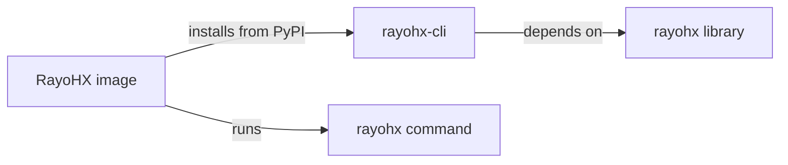

# Architecture

How the RayoHX image is put together. For running it, see the [Docker guide](docker.md); for working on it, see [development](development.md).

## What the image is

The image runs the same `rayohx` command as the Python package. It holds no second downloader: it installs the published `rayohx-cli` package from PyPI, which depends on the `rayohx` library, so the image, the PyPI packages and the installers behave the same way.



The pieces live in separate repositories:

- [RayoHX](https://github.com/coldsofttech/RayoHX) holds the `rayohx` library, the download engine. See its [architecture](https://github.com/coldsofttech/RayoHX/blob/main/docs/architecture.md).
- [RayoHX-CLI](https://github.com/coldsofttech/RayoHX-CLI) holds `rayohx-cli`, the `rayohx` command. See its [architecture](https://github.com/coldsofttech/RayoHX-CLI/blob/main/docs/architecture.md) for the options, settings file and exit codes the image exposes.
- This repository only packages them as a container image. Fix bugs in the command or the engine in those repositories, not here.

## Files

```text
Dockerfile                the two-stage build
Dockerfile.dockerignore   leaves out the build context except requirements.txt
requirements.txt          the pinned rayohx-cli version the image installs
.hadolint.yaml            the Dockerfile lint rules
VERSION                   the image version; a release tag must be "v" plus this
.github/workflows/        ci, security, dependency review and release
docs/                     this documentation
tests/integration/        the image tests (they drive the docker command); see testing.md
scripts/smoke/            a manual check that builds and runs the image
scripts/dev/              local development helpers; see development.md
brand/                    the logo and social preview image
CHANGELOG.md              changes to the image
README.md                 the image for users
```

The build context holds only `requirements.txt`: the command is installed from PyPI at the version pinned there, and Dependabot watches that file.

## Stages

| Stage | Purpose |
| --- | --- |
| `build` | A slim Python image where `rayohx-cli` (the version in `requirements.txt`) and its dependencies are installed into a virtual environment at `/opt/venv`. pip is removed from the environment afterwards. |
| `runtime` | The same slim base with only `/opt/venv` copied in: no compilers and no sources. |

Splitting the stages keeps the final image small and keeps build tools out of it. The Python version is the `PYTHON_VERSION` build argument (default 3.15), and both stages use the same one so the virtual environment matches its interpreter.

The runtime stage also patches the base image. It upgrades only `zlib1g`, upgrades the base image's own pip (an older one bundles a vulnerable `msgpack`) and removes `setuptools` and `wheel`, which the command never uses. Each fix has a comment in the `Dockerfile` naming the advisory, so it can be dropped once the base image catches up.

## The runtime image

- **User.** A fixed system user and group `rayohx` (uid and gid `10001`) with no home folder and no login shell, so files written to a mounted folder have a predictable owner. The image never runs as root.
- **Folders.** `/output` is the working directory and `/workspace` holds partial downloads and resume state (`RAYOHX_WORKSPACE`). Both are declared as volumes and owned by `rayohx`.
- **Entry point.** `ENTRYPOINT ["rayohx"]` with `CMD ["--help"]`, so everything after the image name is a normal command.
- **Environment.** `RAYOHX_WORKSPACE=/workspace` and `NO_COLOR=1` are set. Python output is unbuffered and no bytecode is written. Command line options win over `RAYOHX_` variables.
- **Labels.** The OCI labels (title, description, source, license and `VERSION`) are set so registries show the right details.

## No FFmpeg

Joining audio and video is built into the library, so FFmpeg is not installed. That keeps the image small and removes a large source of vulnerabilities. Someone who needs FFmpeg for an unusual codec builds their own image on top of this one.

## Platforms

The image is built for `linux/amd64` and `linux/arm64`. CI builds your platform only and checks it; a release builds both. See [packaging](packaging.md) for building and [testing](testing.md) for how the image is checked.

## Releases

A release starts when a GitHub release is published with a `v<version>` tag, which must be `v` plus the `VERSION` file. `release.yml` then checks that, builds both platforms and pushes `X.Y.Z`, `X.Y` and, for a full release, `latest`.

| Registry | Image | Turned on by | Credentials |
| --- | --- | --- | --- |
| GitHub Container Registry | `ghcr.io/<owner>/rayohx` | the `PUBLISH_GHCR` variable set to `true` | the workflow's own token |
| Docker Hub | `docker.io/coldsoft/rayohx` | the `DOCKERHUB_USERNAME` variable (`coldsoft`) | the `DOCKERHUB_TOKEN` secret |

Both registries are off until the maintainer turns them on, and each publish job runs in the `docker` environment, so its protection rules and secrets apply to both. The Docker Hub namespace is the username (`coldsoft`) unless `DOCKERHUB_NAMESPACE` in `release.yml` says otherwise. See [packaging and releasing](packaging.md#releasing) for the steps.

## Checks

| Layer | What runs | Where |
| --- | --- | --- |
| Local | file hygiene, Dockerfile and Markdown lint | pre-commit hooks |
| Pull request | CI, security scans and dependency review | GitHub Actions |
| Release | build for both platforms, then publish | `release.yml` |

## Workflows

| Workflow | Purpose |
| --- | --- |
| `ci.yml` | build the image for one platform and run the image tests |
| `security.yml` | security scans of the repository and the workflows |
| `dependency-review.yml` | review the dependency changes in a pull request |
| `release.yml` | check the tag against `VERSION`, build both platforms and publish to GHCR and Docker Hub |

`release.yml` runs when a release is published with a `v` tag. See [packaging and releasing](packaging.md), [testing](testing.md) and [security](security.md).
